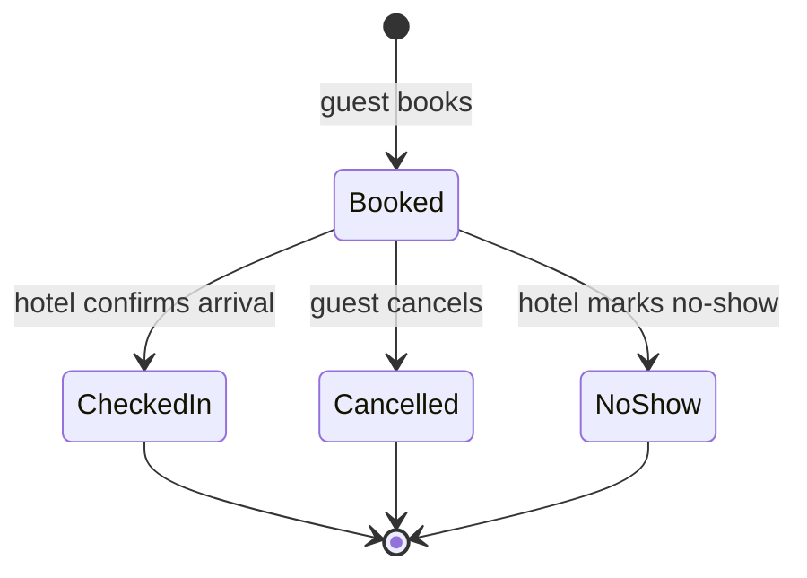
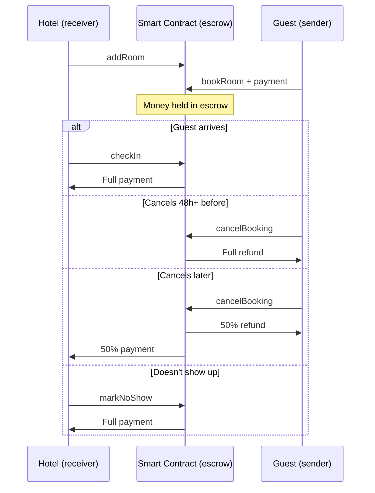

# Design – Hotel Booking DApp

This document describes how my smart contract works before I write any code. The idea is simple: the guest (sender) pays, the hotel (receiver) gets paid, and the contract sits in the middle, holding the money until the rules say where it should go.

## Who does what

- **The hotel** deploys the contract, so its address is saved as the owner. Only the hotel can list rooms, confirm check-ins and mark no-shows.
- **The guest** is any other account. A guest can book a room and cancel their own booking, but nobody else's.
- **The contract** holds every payment in escrow, checks the rules on each action and records what happened as events.

## What the contract stores

A **room** has a name (like "Double Room 101"), a price per night in wei, and two flags: whether it's open for booking and whether it currently has an active booking.

A **booking** links a guest's wallet address to a room, with the check-in date, the number of nights, the amount paid and its status. No names or documents are stored, only the wallet address.

## How each action works

### Listing a room
`addRoom(name, pricePerNight)` – hotel only

The hotel creates a room with its nightly price. It can later open or close the room with `setRoomAvailability(roomId, available)`, for example during maintenance.

Events: `RoomAdded`, `RoomAvailabilityChanged`

### Booking a room
`bookRoom(roomId, checkInDate, nights)` – guest, sends payment

The guest sends the payment together with the booking. The contract only accepts it if the room is open and not already booked, the check-in date is in the future, and the amount is exactly the price per night times the number of nights. The hotel can't book its own rooms. Once accepted, the money stays locked in the contract.

Event: `RoomBooked`

### Cancelling a booking
`cancelBooking(bookingId)` – only the guest who made the booking

If the guest cancels at least 48 hours before check-in, they get everything back. Closer than that, they get 50% back and the hotel keeps the other 50% as compensation for the late notice.

Event: `BookingCancelled`

### Checking in
`checkIn(bookingId)` – hotel only

From the check-in date onwards, the hotel confirms that the guest has arrived, and the contract releases the full payment to the hotel. This is the one step where the guest has to trust the hotel, because the contract can't see who walks through the door.

Event: `CheckedIn`

### Marking a no-show
`markNoShow(bookingId)` – hotel only

If the guest still hasn't checked in 24 hours after the check-in date, the hotel can mark a no-show and receive the full payment. Before that, the contract refuses.

Event: `NoShowMarked`

### Reading information
`getRoom(roomId)` and `getBooking(bookingId)` let anyone check a room or a booking. They only read data, so they cost no gas.

## The life of a booking

Every action starts by checking that the booking is still **Booked**. Once it reaches a final state, no more money can move. This single check is what makes double payments impossible.

## The full flow

## Security

- **Knowing who's calling.** Every action checks `msg.sender`, which the network proves with the caller's ECDSA signature (see Cryptography in the research notes).
- **Safe order of operations.** Each function checks the rules first, updates the booking status second, and sends money last. If an attacker tried to call the function again in the middle of a payment, the status would already have changed, and the call would fail.
- **Clear errors.** Every rule that fails rejects the transaction with a message explaining why, which also makes testing easier.

## How I'll test it

| # | Scenario | Expected |
|---|---|---|
| 1 | Hotel lists a room | Room created |
| 2 | Guest books with the exact amount | Booking created, money held |
| 3 | Guest pays the wrong amount | Rejected |
| 4 | Guest books a room that's already booked | Rejected |
| 5 | Hotel books its own room | Rejected |
| 6 | Guest cancels 48h+ before | Full refund |
| 7 | Guest cancels later | 50% / 50% split |
| 8 | Someone else cancels the booking | Rejected |
| 9 | Hotel confirms check-in | Hotel paid |
| 10 | Hotel confirms the same check-in twice | Rejected |
| 11 | Guest tries to confirm check-in | Rejected |
| 12 | Hotel marks a no-show after 24h | Hotel paid |
| 13 | Hotel marks a no-show too early | Rejected |

For the time-based tests (6, 7, 12 and 13), the Python script will use Ganache's `evm_increaseTime` to move the blockchain's clock forward, so I don't have to wait days to test a cancellation deadline.

